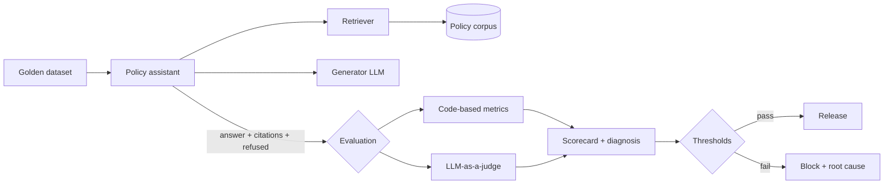

# RAG Evaluation Framework

**Python · LLM Evaluation · LLMOps Focus**

## Overview

This repository demonstrates the design of a failure-mode-driven evaluation framework for a Retrieval-Augmented Generation (RAG) system, using a policy and compliance Q&A assistant as the system under test.

The focus of this project is not the assistant itself, but the evaluation layer around it, including:

- Evaluation design based on system failure points
- Choosing the right evaluation method for each quality dimension
- Translating evaluation signals into engineering actions
- Automated quality gates for release decisions

A working pipeline is included that runs end-to-end: golden dataset → assistant → metrics and judges → report → pass/fail gate.

## Why Evaluation?

Most GenAI systems are validated by checking whether the answer "looks right" in a demo. This approach does not scale and does not explain what to fix when quality drops.

A structured evaluation framework addresses this by:

- Measuring quality systematically across defined dimensions
- Identifying which part of the system is failing
- Making improvements measurable across releases
- Preventing regressions from reaching production

The guiding question: **is the system actually getting better, and how do we know?**

## Architecture Overview

The framework separates the system under test from the evaluation layer:

| Layer | Component | Purpose |
|---|---|---|
| Data | Policy corpus (Markdown) | Source documents, chunked by section |
| Retrieval | BM25 retriever (swappable) | Ranked context with stable chunk IDs |
| Generation | Amazon Bedrock / OpenAI / mock | Answer with citations in a JSON contract |
| Evaluation – Code | Deterministic metrics | Objective checks (retrieval, citations, schema, refusals) |
| Evaluation – Judge | LLM-as-a-judge | Interpretive checks (grounding, relevance, scope) |
| Diagnostics | Metric → component mapping | Points each failure to likely root cause |
| Gate | Thresholds + CI | Blocks release when quality drops |



## End-to-End Flow

1. Configuration and model settings are loaded from YAML and `.env`
2. Policy documents are split into sections with stable IDs (`document#section`)
3. A search index is built over all sections
4. Each golden question is sent to the assistant
5. Relevant sections are retrieved and passed to the generator
6. The assistant returns a structured response: answer, citations, refusal flag
7. Code-based metrics and LLM judges score each response
8. Scores are aggregated and compared against thresholds
9. Failing dimensions are mapped to likely root causes
10. A report is generated and the run passes or fails the quality gate

## What This Project Demonstrates

This project focuses on evaluation engineering concerns, including:

- Designing evaluation around failure modes rather than generic metrics
- Separating deterministic checks from judgement-based checks
- Applying governance principles to GenAI quality:
  - Release gates with explicit thresholds
  - Scope and refusal controls for compliance use cases
  - Traceable, per-question evidence for every score
- Turning evaluation results into targeted engineering decisions

## Evaluation Design Focus

Key areas of focus in this repository:

### Failure Points and Metrics

| Failure Point | Question It Answers | Metric | Method |
|---|---|---|---|
| Retrieval | Did we fetch the right content? | Context precision, context recall | Code |
| Grounding | Is the answer supported by that content? | Faithfulness | LLM judge |
| Citations | Do cited sources back the claim? | Citation accuracy | Code |
| Answer | Does it address the question? | Answer relevance | LLM judge |
| Scope | Does it stay within policy and avoid advice? | Scope adherence | LLM judge |
| Scope | Does it decline when evidence is missing? | Refusal accuracy, false/missed refusal rates | Code |
| Structure | Does output follow the contract? | Schema validity | Code |

### Method Selection

- **Code-based evaluation** for anything objective: schema, required fields, expected sources, refusal behaviour. Fast, free, deterministic, and no calibration needed.
- **LLM-as-a-judge** for anything that needs interpretation: grounding, relevance, scope adherence.

### Diagnostics

Each evaluation signal points to where intervention is required:

- Retrieval degradation → chunking, embeddings, `top_k`, search configuration
- Grounding failures → prompt design, context construction, model behaviour
- Citation inaccuracies → source attribution, chunk-ID propagation
- Missed refusals → evidence-sufficiency checks
- Schema failures → structured output, validate-and-retry

### Judge Reliability

- Rubric prompts require reasoning before the verdict
- Judges return categorical verdicts; scores are computed in code
- Unparseable judge outputs are recorded as errors, not scores, and the judge error rate is gated
- Generator and judge are configured independently to allow different model families

### Fail Loudly

The pipeline is designed so that nothing that went wrong can be reported as a pass:

- **Preflight health check:** one real call to each model before the run; bad credentials, region or model access stop the run immediately (exit code 2)
- **No silent fallbacks:** mock mode is only used when explicitly configured, and is labelled in every log and report
- **Failure isolation:** an API error on one question is recorded and the run continues, and the item error rate is gated
- **Unmeasured is not passed:** a gated dimension with no scored items fails the gate
- **Targeted retries:** only transient errors (throttling, timeouts) are retried; permission and validation errors fail immediately
- **Structured logs** (`key=value`) to stderr; the report goes to stdout and `reports/`

### Quality Gate

- Thresholds defined per dimension in `config/eval_config.yaml`
- Stricter thresholds for high-risk dimensions (schema, scope)
- False and missed refusal rates gated separately
- Judge error rate and item error rate gated, so scores are never computed on a silently shrunken dataset
- Exit codes: `0` passed, `1` gate failed, `2` preflight failed; enforced in GitHub Actions

### Golden Dataset Design

The golden set has 105 questions across eight synthetic policy documents, designed to test specific behaviours rather than just coverage:

| Category | n | What it tests |
|---|---|---|
| factual | 46 | Direct lookup of a single policy fact |
| paraphrase | 19 | The same facts asked in everyday language |
| multi_hop | 5 | Answers that need two sections, sometimes across documents |
| false_premise | 5 | Questions built on a wrong assumption the assistant must correct |
| unanswerable_near_miss | 17 | On-topic questions the documents do not answer |
| unanswerable_out_of_domain | 13 | Questions unrelated to the policies |

The golden set is tested too: unknown chunk IDs, inconsistent labels, unknown categories, or fewer than 25 unanswerable questions fail CI.

### Traceability

Every run writes a `manifest.json` so results are reproducible and comparable:

- SHA-256 hashes of the golden set, the corpus, the assistant prompt and every judge prompt
- Generator and judge model IDs, including the exact version the provider reports
- Retrieval settings, thresholds and provider configuration
- Git commit, and whether there were uncommitted changes
- Token usage per role, and cost when prices are configured (never reported as zero when unknown)

Two runs are comparable only when their dataset, corpus and prompt hashes match.

## Key Finding

The evaluation design surfaced the same failure twice, and the second time showed how much a small test set can understate it.

**With 25 questions (5 unanswerable):**
- Overall refusal accuracy: **0.92**, passing the 0.90 threshold
- Missed refusal rate: **0.40**, or 2 of 5 unanswerable questions answered anyway

**With 105 questions (30 unanswerable):**
- Missed refusal rate: **0.77**, or 23 of 30 unanswerable questions answered anyway
- Near-miss questions: **0 of 17** correctly refused

Two lessons came out of this:

1. **Aggregates hide minority-class failures.** This is why false and missed refusal rates are gated separately from overall refusal accuracy.
2. **A small golden set can make a serious failure look moderate.** Five unanswerable questions were enough to detect the problem, but not to size it. The per-category breakdown then located it: on-topic questions the documents don't answer.

The diagnosis traced the misses to topically similar sections scoring high on keyword retrieval, which points to the need for a semantic evidence-sufficiency check. These results are from mock mode, so they describe the retrieval-threshold approach, not a specific LLM.

## Tradeoffs Considered

**Code-based metrics vs LLM judges:** code for objectivity, cost and reproducibility; judges only where semantic interpretation is required.

**Aggregate scores vs per-class error rates:** aggregates are easy to report but hide minority-class failures; error rates are gated separately for refusal behaviour.

**BM25 vs vector search:** BM25 keeps the demo dependency-free and deterministic; the evaluation layer depends only on ranked chunks with stable IDs, so the retriever can be swapped for Bedrock Knowledge Bases or OpenSearch without changing any metric.

**Same vs different judge model:** a judge from the same model family as the generator risks self-preference bias; the framework configures them independently.

## Demo

The implementation runs in two modes:

- **Mock mode:** extractive generator and heuristic judge. Runs offline with no API keys; used to validate the pipeline and in CI.
- **Live mode:** Amazon Bedrock or OpenAI for both generation and judging.

Run the tests and the offline pipeline:

```bash
pip install -e ".[dev]"
pytest -q
python -m evalkit --provider mock
```

Run against Amazon Bedrock:

```bash
pip install -e ".[bedrock]"
cp .env.example .env        # set AWS_REGION, GENERATOR_MODEL, JUDGE_MODEL
python -m evalkit --provider bedrock --limit 3   # quick smoke test first
python -m evalkit --provider bedrock
```

Each run produces `reports/<run_id>/` containing:

- `report.md`: scorecard, results by question category, and diagnosis
- `summary.json`: aggregate results and gate decision
- `results.jsonl`: per-question details, including judge reasoning
- `manifest.json`: dataset, corpus and prompt hashes, models, configuration, git commit, token usage and cost

## Scope Clarification

This project is intentionally designed as an evaluation design demonstration, not a production-ready system.

- The policy corpus is synthetic, for a fictional company; no real customer or proprietary data is used
- The retriever is a lightweight stand-in for a managed vector store
- Mock mode validates the pipeline, not model quality
- Live provider code paths are unit-tested with stubbed model responses; run a small `--limit` smoke test against your own models first
- Emphasis is on evaluation design decisions, not the assistant's capabilities

## Extensions

Potential extensions of this framework include:

- Judge calibration against human labels (Cohen's κ, position and verbosity bias tests, repeat-run consistency)
- Semantic evidence-sufficiency check: answer, qualify or abstain
- Retrieval comparison: keyword, dense, hybrid and re-ranking with Amazon Bedrock Knowledge Bases
- Agent evaluation: tool selection, argument accuracy, trajectory scoring
- Run-over-run comparison using manifest hashes to detect regressions

## Related Work

This repository is part of a broader focus on AI Platform Engineering and LLMOps:

- [Secure RAG AI Platform on AWS](https://github.com/vrushalirao25/secure-rag-ai-platform): architecture and governance for enterprise RAG

## About the Author

Vrushali Rao is a GenAI Technical Lead focused on AI Platform Engineering, LLMOps, and AI systems enablement.

With 11+ years of experience across software engineering, platform systems, cloud infrastructure, and cross-functional technical delivery, she works on GenAI system design, evaluation and quality standards, AI platform governance, and scalable infrastructure for production AI systems.

Areas of interest include GenAI systems, LLM evaluation, AI Platform Engineering, MLOps governance, and AWS architecture.

GitHub: https://github.com/vrushalirao25

LinkedIn: https://linkedin.com/in/vrushali-rao

## Summary

This repository demonstrates how to design evaluation for GenAI systems as an engineering discipline: starting from failure points, choosing the right measurement method for each, and turning quality signals into targeted improvements and release decisions.

The goal is to showcase evaluation-driven thinking, not just model output.
